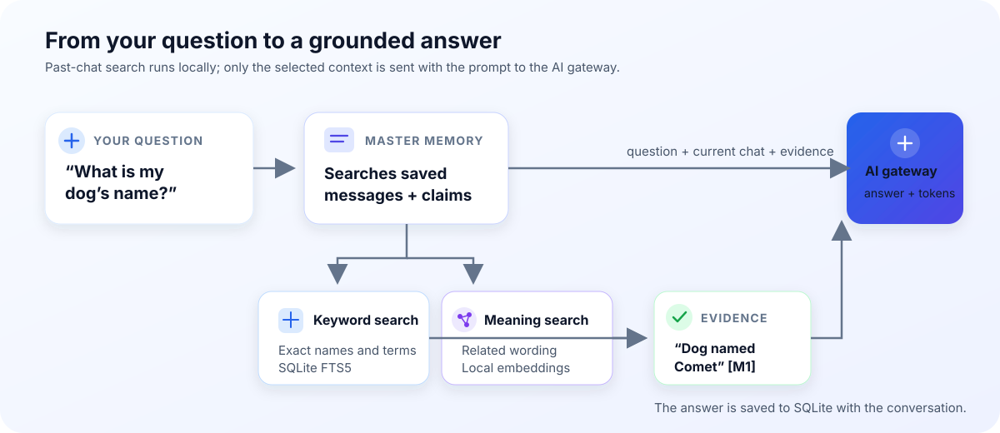
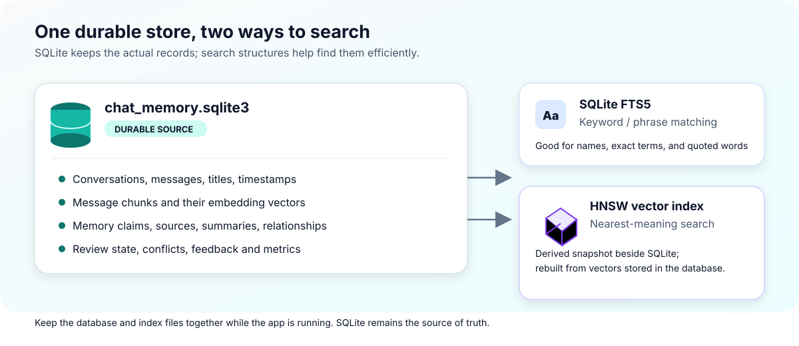
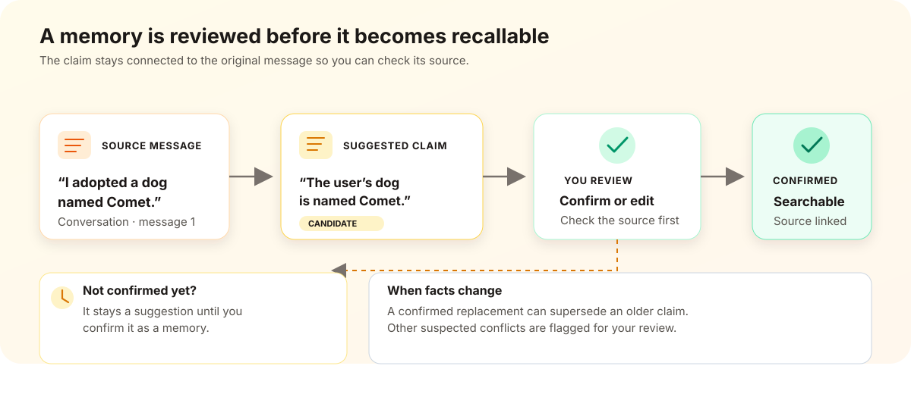

# AI Class Student

Python clients for the class AI gateway.

## Setup

```bash
python3 -m venv .venv
source .venv/bin/activate  # Windows: .venv\Scripts\activate
pip install -r requirements.txt
```

Set the gateway URL and your key in the shell, or put them in a local `.env`
file (which is gitignored):

```bash
AI_CLASS_BASE_URL="https://ai.example.org/v1"
AI_CLASS_API_KEY="aiclass_your_key"
```

Never commit or share your API key.

## Run

Run the persistent chat app:

```bash
python master_chat.py
```

Or run a non-persistent chat that only uses recent messages:

```bash
python -m Archives.short_term_gradiochat
```

These standalone tools and older coursework files are kept in `Archives/`;
the persistent master chat does not depend on them.

## Persistent chat and memory

`master_chat.py` runs the Gradio interface. `master_memory.py` provides the
storage and retrieval functions used by the chat. The local
`chat_memory.sqlite3` database is the durable source of truth; it preserves
chats and memories across app restarts.

### What happens when you chat

1. The chat loads the selected conversation from SQLite and displays it.
2. When you send a message, `master_chat.py` asks `master_memory.py` to search
   past messages and confirmed memories using the prompt and recent user turns.
   Search combines meaning-based vector search with SQLite full-text keyword
   search. Relevant conversation summaries can help point to likely chats.
3. The app sends the current conversation and retrieved evidence to the chosen
   model through the configured AI gateway. Retrieved evidence is labeled with
   source citations. The UI shows the evidence and API-reported token counts.
4. The user and selected assistant reply are saved in SQLite. In **Both** mode,
   both drafts are shown, but only the chosen reply is saved.

### What the memory module and database do

- SQLite stores each conversation's messages, title, and timestamps. It also
  stores memory claims, their source messages, review status, summaries,
  relationships, potential conflicts, and retrieval feedback/metrics.
- Long messages are split into overlapping chunks. The local embedding model
  creates vectors for semantic matching; SQLite FTS5 maintains a keyword
  index. For larger archives, a derived HNSW vector index is checkpointed
  beside the database and can be rebuilt from the stored vectors.
- `master_memory.py` keeps these indexes in sync when conversations change,
  combines keyword and semantic rankings, and returns source-linked evidence.
  Summaries guide retrieval but are not treated as original evidence.
- Suggested memories start as candidates and are not retrieved until confirmed.
  Confirmed claims can be connected to related claims; suspected conflicts are
  shown for review rather than silently resolved.
- Deleting a conversation also deletes its source-linked memories and
  summaries. Keep the database and its adjacent index files together; deleting
  the database removes your saved chats and memories.

### Chat interface guide

The main chat is on the left. Summary, memory-review, and evidence tools are in
the right-hand panel.

#### Chat controls

- **Responding model:** Choose **5-mini** or **Luna** for one answer. Choose
  **Both** to request two drafts from the same chat and retrieved context.
- **Message box / Send:** Type a message and click **Send**, or press Enter.
  The current conversation and relevant past-chat evidence are included as
  context for the model. The selected answer is saved automatically.
- **Use Luna response / Use 5-mini response:** In **Both** mode, compare the
  drafts and click the button under the answer you want to keep. Only that
  answer is saved to the chat.
- **New chat:** Start a separate conversation. Existing conversations and
  memories remain saved and searchable.
- **Past chats:** Select a saved conversation to reopen it. The list is titled
  from each conversation's first user message.
- **Token counter:** Shows gateway-reported input and output tokens for the
  latest request and the accumulated total for this browser session. **Both**
  adds usage from both drafts. Starting a new chat or opening another saved
  chat does not reset the total; a new browser session does.

#### Past-chat summary

- Click **Summarize my past chats** to create or refresh per-conversation
  summaries and an overall profile.
- **What I know about you** shows the overall profile. **Per-conversation
  summaries** shows the individual summaries.
- Summaries help guide searches, but the answer should rely on retrieved
  message or confirmed-memory evidence. Editing a conversation makes its old
  summary stale until refreshed.

#### Memory review

Memories are short, reviewable facts linked to the messages they came from.
Only claims with **confirmed** status are used as saved memories in retrieval.

- **Conversation to extract suggestions from:** Choose a saved chat, then
  click **Suggest memories from selected chat**. The app asks 5-mini for
  durable preferences, goals, projects, or constraints. Suggestions are not
  confirmed automatically.
- **Source user message for a new memory / New memory claim / New memory
  category:** To add one yourself, pick the conversation and source user
  message, enter a concise claim and category, then click **Add memory
  candidate**. For example, source message `I prefer short, practical
  explanations` could become claim `Prefers concise explanations`, category
  `communication preference`.
- **Supersedes memory (optional):** When adding a replacement, select the
  older claim this new claim replaces. After reviewing the new claim, saving
  it as **confirmed** marks the older claim superseded.
- **Saved memory claims:** Select a suggestion or existing claim to inspect and
  edit it. **Memory**, **Category**, and **Status** are editable. **Source
  evidence** shows the source conversation and original message for review.
  Click **Save / update memory** to apply edits or confirm/dispute a claim.
- **Potential claim conflicts / Conflict details:** Select a flagged pair to
  see why it was flagged and read both claims. Choose **resolved** or
  **dismissed**, then click **Resolve / dismiss conflict**. Flags are review
  prompts; they do not automatically decide which fact is correct.
- **Related memory source / Related memory target / Relationship:** Choose two
  confirmed claims, describe their connection (for example `has breed` or
  `belongs to project`), then click **Connect memories**. These links can help
  retrieval find nearby related facts.
- **Memory relationships:** Shows saved links between claims.
- **Delete memory:** Permanently removes the selected claim and its links.
- **Delete selected conversation and memories:** Deletes that conversation,
  its messages, and memories sourced from it. This cannot be undone.

#### Retrieved evidence and feedback

- **Memory evidence used for the last answer:** Shows the sources provided to
  the model for its latest response. A marker such as `[M1]` refers to an item
  in this evidence.
- **Rate an evidence item / Was it helpful? / Save feedback:** Pick a source,
  rate it **Helpful** or **Not helpful**, then save. Repeated feedback for the
  same query may modestly influence that source's future ranking.

#### Example workflows

**Recall a detail from an older chat**

1. Select **5-mini** (or **Luna**) and ask, for example, “What did I name my
   dog?”
2. The app searches saved messages and confirmed memories; you do not need to
   reopen the source chat first.
3. Check **Memory evidence used for the last answer** to see what was found
   and which source supports the answer.
4. If the answer used a retrieved fact, it should include its `[M#]` citation.
   If the evidence is not relevant, rate it **Not helpful**.

**Compare two answers**

1. Choose **Both** and send your prompt.
2. Read the Luna and 5-mini drafts side by side.
3. Click **Use Luna response** or **Use 5-mini response**. The selected answer
   is added to the conversation; the other draft is not.
4. The token counter reports usage for both requests combined as well as the
   session total.

**Save and use a durable memory**

1. Select a conversation and click **Suggest memories from selected chat**, or
   add a claim manually using a source user message.
2. Select the candidate under **Saved memory claims** and verify its text and
   **Source evidence**.
3. Edit it if needed, then set **Status** to **confirmed** and click **Save /
   update memory**.
4. In a later chat, ask a related question. The confirmed claim may appear in
   the evidence panel with its source.

Your prompts, active chat history, retrieved excerpts, and any content sent for
summaries or memory suggestions go to the configured AI gateway. Local chat
history is accessible to anyone with access to this computer or database; avoid
storing sensitive information.

Run the memory and chat tests with:

```bash
python -m unittest test_chat_memory.py
```

## Visual examples

### Example 1: From a question to a cited answer



The search approaches complement each other. Keyword search can be strong when
you remember an exact name such as `Comet`; meaning-based search can help when
you ask about a "pet" instead of using the original word "dog." The app blends
their rankings, then sends selected source text—not just a search score—to the
model. A citation points back to the retrieved evidence; it does not mean the
model independently verified that the statement is true.

The database search happens locally. The current conversation and selected
retrieved excerpts are sent to the configured AI gateway so it can write an
answer. The token display reports the gateway's input and output token counts.
With **Both**, counts for both drafts are shown and combined; if citation
retry is needed, its tokens are included.

### What gets stored, and where



SQLite contains the conversations, the embedding values, and the FTS5 keyword
index. The adjacent HNSW file is an additional search structure for finding
nearby message vectors quickly in a large archive. It is derived data, not a
second copy of your chat history; if it is missing or out of date, the app can
rebuild it from embeddings in SQLite. Avoid deleting or moving database/index
files while the app is running.

### Example 2: A conversation fact becomes a saved memory



The claim is separate from the original message: it is a concise way to recall
a potentially useful fact, and its source link lets you inspect the evidence.
Confirmation is your review step; it does not rewrite the conversation.

If you later add a replacement such as `My dog is now named Nova`, the app can
mark the earlier claim superseded when you confirm the replacement. Both claims
remain understandable in their source conversations, while only the active,
confirmed claim is used for memory search. Possible contradictions that are
not explicit replacements are flagged for review rather than automatically
decided.

### Example 3: Why both a conversation and a memory are useful

Use the conversation record when the exact wording and surrounding context
matter. Use a confirmed memory for a short, durable fact that is likely to be
useful again. Both can appear in retrieval, and the UI shows the evidence used
for an answer so you can check what the model relied on.
